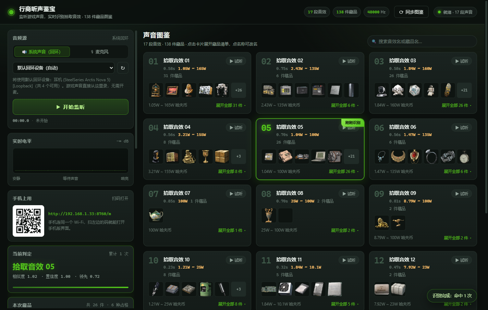
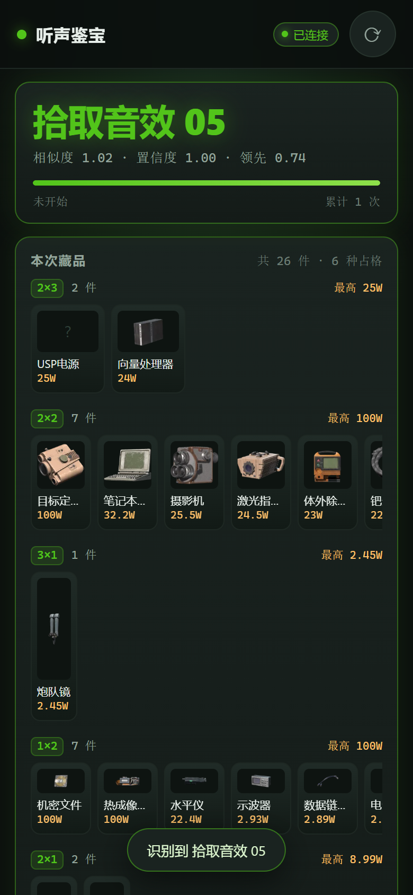
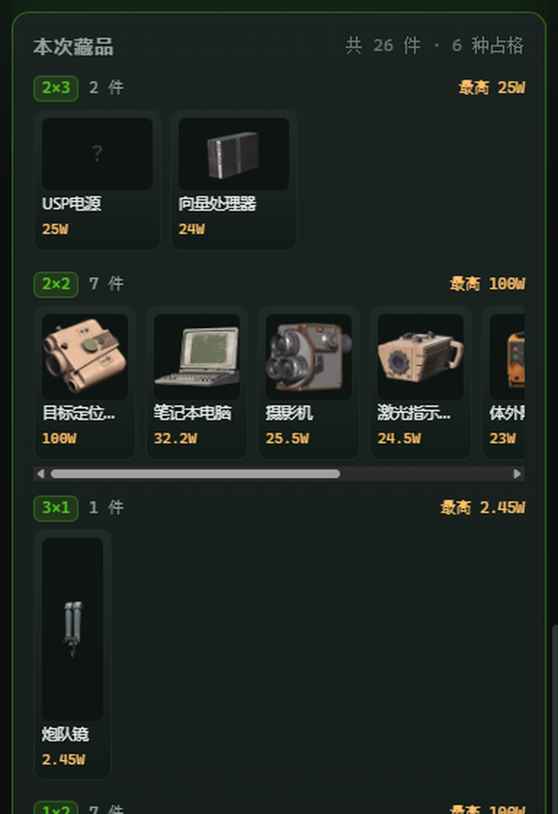

# 行商听声鉴宝 · 本地实时声音识别器（Python 版）

在暗区突围里听到一声**拾取音效**，这个工具告诉你：这是图鉴里的第几段音效，以及它可能是**哪些藏品**。



三种用法：

- **实时监听**——直接抓系统声音（WASAPI 回环），游戏里一响就自动识别，命中记录滚动出现；
- **文件识别**——把录好的 wav / mp3 / flac 拖进去，一次给出全部命中；
- **手机上用**——服务启动后会打印局域网地址和二维码，手机连同一个 Wi-Fi 扫码打开 `/m`，打游戏时不用切回电脑。

两个电脑端界面，同一个后端、同一场监听：

| 界面 | 地址 | 布局 |
| --- | --- | --- |
| 图鉴页 | `/` | 左边识别、右边 17 张声音图鉴卡（换音效、查藏品） |
| **监视台** | `/live` | 左边专心看当前判定，**命中记录在右栏**，滚上去能翻一整局的命中历史 |

打游戏的时候推荐用 `/live`：命中记录单独占一栏，不会把判定结果挤出屏幕。

<p>


</p>

识别到音效后，面板按**占格分组**列出这件音效可能对应的全部藏品：同一占格排一行，行内价值从高到低。

声音**不出本机**：没有联网请求，没有上传，参考音效和特征库都在 `data/` 里。
（唯一的出站请求是主动点「**同步图鉴**」时去暗区情报站抓数据。）

> 声音图鉴数据来自 [暗区情报站 · 行商听声鉴宝](https://aqtwwx.net/listen-treasure)：
> 17 段拾取音效 / 138 件藏品 / 136 张藏品缩略图。
> 这些素材**不进仓库**，首次运行会自动抓一次（约 2~3 分钟 / 17 MB）。

---

## 快速开始

```bat
REM 双击 start.bat 即可（会自动找 Python、自动补依赖、自动开浏览器）
REM start.bat 默认带 --lan，手机能直接连
```

命令行方式：

```bash
python -m pip install -r requirements.txt
python scripts/run.py                 # 默认 http://127.0.0.1:8756，自动开浏览器
python scripts/run.py --lan           # 同时监听 0.0.0.0，手机可访问 + 打印二维码
python scripts/run.py --port 9000     # 换端口（被占用会自动往后找空位）
python scripts/run.py --no-browser    # 只起服务
python scripts/run.py --no-qr         # 启动横幅不打二维码
python scripts/run.py --rebuild       # 启动前重建声音库
```

**首次运行会自动抓数据**：`data/` 不在仓库里，第一次启动时 `run.py` 会先连
[aqtwwx.net](https://aqtwwx.net/listen-treasure) 抓 17 段音效 + 136 张藏品图（约 2~3 分钟），
然后建库、起服务。之后启动是秒开（实测库加载 10.6 ms）。抓不下来时手动跑 `python scripts/crawl.py` 看具体报错。

**环境要求**：Python 3.10+，Windows（实时监听依赖 WASAPI，只在 Windows 上可用；文件识别是跨平台的）。

`start.bat` 的解释器查找顺序：`LISTEN_PYTHON` 环境变量 → 同目录的 `.python` 文件（里面只写一行 python.exe 的绝对路径）→ `PATH` 里的 `python` / `py -3` / `python3` → 常见安装位置。

## 在手机上用（打游戏时不用切回电脑）

1. 用 `python scripts/run.py --lan`（或双击 `start.bat`）启动。启动横幅会打印：

   ```
   电脑：  http://127.0.0.1:8756/
   手机：  http://192.168.1.33:8756/m
   接口：  http://192.168.1.33:8756/api/health
   ```

   下面还有一块终端二维码。**电脑版页面左下角「手机上用」也有同样的码**，扫哪个都行。

2. 手机连**同一个 Wi-Fi**，相机扫码直接打开手机版。打不开就检查：
   - 手机和电脑是不是真的同一网段（公司/校园网常开客户端隔离）；
   - Windows 防火墙有没有放行 Python（第一次启动会弹提示，要允许**专用网络**）；
   - 服务是不是用了 `--lan`（只用 `127.0.0.1` 监听时手机连不上，页面上会把这个状态直接标红）。

3. 手机版界面：大字判定结果 + 按占格分组的藏品 + 电平条 + 音频源下拉 + 开始/停止 + 命中记录 + 文件识别。
   和电脑版共用同一个后端，所以**两边看到的是同一场监听**——在电脑上开始监听，手机上是同步的。

## 同步图鉴（从暗区情报站抓数据）

页面右上角的 **⟳ 同步图鉴** 按钮会重新抓一遍站点数据：

- 17 段音效 → `data/sounds/*.wav`
- 136 张藏品原图 → `data/items/*.png`
- 138 件藏品的对应关系和新价格 → `data/codex.json`

命令行等价操作（想加参数就用这个）：

```bash
python scripts/crawl.py                  # 完整抓取（约 2~3 分钟，首次下载 17MB）
python scripts/crawl.py --no-images      # 只更音频和对应关系，不碰图
python scripts/crawl.py --force          # 忽略已有文件，全部重下
python scripts/crawl.py --data-dir data-test   # 改到别的目录（自测用，不覆盖正式数据）
python scripts/build_library.py          # 抓完要重建识别库（界面上的按钮会自动做这步）
```

抓取会自动跳过已存在的文件（第二次跑只要 6 秒），失败项会列出来但**不影响识别**——站点上有 2 件藏品本来就没有图（404）。

点界面上的按钮时，后端抓完会**自动重建识别库并热替换内存里的实例**（1.3 秒），
不用重启服务、也不会打断正在进行的监听。`scripts/crawl.py` 是独立进程，所以它跑完还得手动
`build_library.py`（或下次启动加 `--rebuild`）。

> 站点接口挂了签名校验（`X-Abc` / `X-Xyz` / `X-Qwe` 三个头，`X-Qwe` 是 512 位 RSA
> PKCS#1 v1.5 加密的 `时间戳:随机串`）。`listen_treasure/crawler.py` 里手写了
> 最小可用的 RSA 实现，所以**不需要 cryptography / pycryptodome** 这类重依赖。
> 另外站点会把 SPA 的 HTML 当 200 返回，所以下载时会校验 `RIFF` / `PNG` 文件头。

## 怎么用

1. 打开页面，等右上角显示 **就绪 · 17 段声音**。
2. 左栏「音频源」选 **🔊 系统声音（回环）**，设备默认就是系统输出（自动选中 WASAPI 回环设备），点 **开始监听**。
   - 想用麦克风就切到 🎙 —— 但回环是首选：它拿到的就是游戏实际播放的采样，没有房间混响和麦克风频响。
   - **不要**把系统音量静音：回环抓的是输出流的采样，静音后流仍然有数据，但如果游戏本身把音效调成 0 就真没了。
3. 游戏里响一声，左栏依次更新：
   - **实时电平**：160 根柱子，能看到音效的包络；
   - **当前判定**：大字是命中的音效名，下面一行是 `相似度 · 置信度 · 领先幅度`，进度条是置信度；
   - **本次藏品**：按占格分组列出这件音效可能出现的全部藏品，**同一占格排一行、行内价值从高到低**，行也按面积从大到小排；
   - **命中记录**：每次确认一条，带时间戳和该音效对应的藏品数量，点一行可以跳到右边对应卡片。
4. 右栏「声音图鉴」：17 张卡，每张卡是「一段音效 → 它可能对应的全部藏品」。
   - **▶ 试听** 播原音效（方便你人耳比对）；
   - **展开全部 N 件** 看这件音效对应的藏品清单（缩略图 + 名字 + 占格 + 哈夫币参考价值）；
   - 点卡片标题可以**改名**，名字写进 `data/name-overrides.json`，重建库也不会丢；
   - 搜索框同时匹配音效名和藏品名。
5. 手头有录音就用「文件识别」：点虚线框或拖文件进去。
6. 嫌命中记录一直挤在左栏就跟不上判定了 → 点顶栏的 **监视台 ↗**（`/live`），
   命中记录挪到右栏，左栏只剩当前判定、电平和藏品，打游戏时瞄一眼就够。

### 为什么是"听"而不是"读游戏内存"

读内存、挂钩子、截包都属于外挂行为。这里走的是和暗区情报站桌面端一样的思路：
**只采集能听到的声音，本地比对**，不碰游戏进程、不注入、不模拟键鼠。

---

## 识别是怎么做的

整条流水线在 `listen_treasure/dsp.py`，一句话概括：
**48 kHz 单声道 → 降噪 → 128 ms 补丁 → 64 维 log-mel 频谱 → 1536 维余弦相似度 → 时间轴上的确认逻辑。**

### 1. 特征：不是 MFCC，是整块 log-mel 频谱图

| 参数 | 值 | 为什么 |
| --- | --- | --- |
| 采样率 | 48000 Hz | 游戏音效高频成分多，16 kHz 会把 8k 以上全砍掉 |
| 帧长 / 帧移 | 1024 / 256 样本（21.3 ms / 5.33 ms） | 帧移细一点，短音效（最短 0.235 s）才切得动 |
| mel 带数 | 64 | |
| 频率范围 | 40 – 16000 Hz | |
| 补丁 | 24 帧 = 128 ms = **1536 维** | 一帧（64 维）信息量太少，噪声下容易飘；整块频谱图保留了包络形状 |

一个补丁就是把 24 帧的 64 维 log-mel 拼成 1536 维向量，再做 **L2 归一化**，
所以匹配就是一次矩阵乘法 + 余弦相似度（`library.matrix @ patch`，203×1536 的矩阵，实测约 **17 µs**）。

整条流水线（降噪 + 加窗 + FFT + mel + 匹配）实测 **约 290 µs/补丁**，
补丁每 5.33 ms 出一个 —— 也就是 **18 倍实时速度、单核占用约 5.5%**，游戏里挂着不影响帧数。

对数能量的地板是**相对**的（`LOG_FLOOR_DB = -20`，相对本补丁最响的带）：
回环录音整体可能只有 -30 dBFS，用绝对地板会把所有带夹成同一个常数。
补丁归一化（`dsp.normalize_patch`）是「夹地板 → 减去均值 → L2 归一化」三步，
减去均值这一步很关键：它把"整体音量"这个维度消掉，剩下的是**频谱形状**。

实测音量无关性（把 #5 的 PCM 整体乘以不同增益，最高相似度）：

```
gain 1.00: score=1.0172      gain 0.25: score=1.0172
gain 0.50: score=1.0172      gain 0.10: score=1.0172
                             gain 0.03: score=1.0171
```

也就是说**游戏音量调小不影响识别**——谱减的增益是 `power / (power + α·noise)` 这种比值形式，
信号和噪声一起缩放，SNR 不变，所以整条链路对线性增益基本免疫。
实测从满音量一直衰减到 -30 dB（`maxLevel=-106 dBFS`），相似度仍是 1.014。

### 2. 背景降噪：两阶段，这是整个项目最容易调错的地方

`listen_treasure/dsp.py` 的 `NoiseReducer`：高通 → 谱减（噪声谱自适应跟踪）→ 加权 OLA 合成，外加一个时域电平门。

**关键决定：建库（模板）和实时识别用两套完全不同的参数**（`config.TEMPLATE_NOISE` / `config.RUNTIME_NOISE`）：

| | 建库 `TEMPLATE_NOISE` | 实时 `RUNTIME_NOISE` |
| --- | --- | --- |
| 策略 | 保守 | 激进 |
| 高通 | 60 Hz | 120 Hz |
| 过减因子 | 0.8 | 2.0 |
| 增益地板 | -6 dB | -18 dB |

理由很直接：**模板是识别基准**，削太狠会让同一段音效自己都认不出来（自识别分数从 1.0 掉到 0.7 以下）；
而实时输入里的环境音是纯干扰，能压多低压多低。

噪声谱估计的几条规则（都在 `_update_noise` 里）：

- 开头 5 帧直接平均，快速建立初值；
- **安静帧**（能量比低、热点占比小）用 0.55 的快速跟踪，跟得上环境变化；
- **宽带突发**（超过 1/3 的频带同时超阈值——音效、说话、枪声都这样）**完全不动噪声估计**，
  否则音效会把自己写进噪声谱，然后被自己减掉；
- 中间地带混一点长窗口场景估计（`noise_scene`，跟踪系数 0.02）兜底，防止估计卡在旧环境上。

**瞬态保护**：如果某一帧的能量比左右邻帧均值高出 2 倍以上，把过减因子降到 1.0（只轻度降噪）。
音效的上升沿是整个音效里最有辨识度的部分，被当成噪声抹掉就废了。

**流式合成的正确性**：`push()` 用**绝对位置对齐的加权 OLA**——每个分析帧按它在整条流里的绝对样本位置累加，
同时累加窗函数的平方做归一化。这样即使增益恒为 1，输出也与输入逐样本相等（完美重建）。
早期版本按"本次 push 里的第几个帧"累加，跨 push 边界的重叠区错位，输出越来越长且对不上原音，自识别直接崩。

### 3. 匹配与确认

`listen_treasure/matcher.py` 把一个一个补丁的相似度，折叠成"命中事件"：

- **粗筛**：`min_score = 0.5` 且 `min_gap = 0.06`（和"别的音效"第一名至少差这么多）；
- **累积**：同一段音效连续达标就攒成一个候选，记下**整段候选**的峰值分、峰值 gap、
  达标帧数 `votes`，以及"超出 0.5 的分数总和" `mass`；
- **迟滞释放**：最后一次达标后要安静 **25 帧（≈133 ms）** 才结算。太短会把一段音效报成十几次，太长会吞掉连点；
- **结算**：两条路满足任意一条就报出去（`Matcher.accepts()`）：

| | 强证据 `strong` | 持续证据 `persistent` |
| --- | --- | --- |
| 峰值相似度 | ≥ 0.85 | ≥ 0.76 |
| 峰值 gap | ≥ 0.06 | ≥ 0.28 |
| 证据量 | — | `mass` ≥ 2.5 |
| 达标帧数 | ≥ 3 | ≥ 3 |

  强证据就是"这一下非常像"，用来守住干净场景；持续证据是"分数没那么高，但连续十几帧都稳定压着别的音效"，
  用来捞被背景盖住的音效。`engine.py` 显示"当前判定"时也调同一个 `accepts()`，两处不会走岔。

置信度不是相似度本身，而是 `confidence_of(score, gap)`：

```python
s = clamp((score - 0.35) / 0.5)          # 相似度归一化
g = clamp(gap / 0.12)                     # 领先幅度归一化
confidence = (0.55*s + 0.45*g) * (0.75 + 0.25*s)
```

只用 gap 不够（环境音里所有模板都很差，gap 仍可能到 0.05）；只用相似度也不够（两段相似音效会一起高分）。
乘上 `(0.75 + 0.25*s)` 是为了"相似度低就别太笃定"。

### 4. 模板取样：覆盖度 ↔ 区分度

音效只有 0.235 – 0.853 s，而一个补丁就 128 ms，所以一段音效能切出的补丁是有限的。
建库时（`dsp.anchor_patches`）用**两套策略合并去重**：

1. **峰值中心簇**：以能量峰值为中心，±6 帧内铺开取 4 张；
2. **有声区间铺开**：能量 ≥ 峰值 × 0.12 的区间里每隔 3 帧取一张。

只用策略 1，游戏里"声音已经开始才捕获到"就认不出来（丢头场景只有 5/17）；
只用策略 2，音效开头覆盖不到，而且模板太多会让 top-1 更容易跳到别的音效上。
两边合并后：**17 段音效 / 341 张模板 / `lib.matrix.shape = (203, 1536)`**
（`MATCH_DEFAULTS["top_refs"] = 12` 是**上限保护**，不是固定值——曾经这里硬截到 4 张，
把密集采样的模板砍掉后半段，丢尾场景从 10/17 直接掉到 1/17）。

### 5. 补丁窗口长度：128 ms 是标出来的，不是拍的

窗口长度直接决定"一个补丁里装多少包络"。太短，短音效被切成碎片、背景更容易冒充；
太长，一窗里混进前后静音，被背景盖住时相似度掉得更狠。实测（17 段，用真实回环录音做主判据）：

| 窗口 | 连续拼接 | 背景 +0 dB | +6 dB | +10 dB | 真实回环录音 | 纯背景误报 |
| --- | --- | --- | --- | --- | --- | --- |
| 32 帧 (170 ms) | 17/17 | 16/17 | 14/17 | 13/17 | 10/17 | 0 |
| 28 帧 (149 ms) | 17/17 | 16/17 | 14/17 | 13/17 | 11/17 | 0 |
| **24 帧 (128 ms)** | **17/17** | **17/17** | **14/17** | **13/17** | **11/17** | **0** |
| 20 帧 (107 ms) | 17/17 | 17/17 | 15/17 | 14/17 | 11/17 | 0 |

再往下探（12 / 14 / 16 帧）在真实录音上能到 13/17，但**那是假象**：
多出来的命中几乎全是同一段音效被反复误判（14 帧时 6 条重复、顺序只对 2/17），
而且更短的窗口在纯背景上误报更多（14 帧 3 次、16~20 帧各 2 次、24 帧 1 次）。
**24 帧是"召回最优 + 误报拐点"的折中。**

### 6. 被背景盖住时怎么还能认出来

先说清楚**不是**音量问题：把音效整体乘 0.001（-60 dB）仍然 17/17
——`normalize_patch` 做的是「夹相对地板 → 减均值 → L2」，整个补丁乘常数不改变结果。

真正掉召回的是**窄带、持续、音调性的背景**（BGM、环境嗡鸣）。用机器上实录的
30 秒游戏背景做掩蔽标定（17 段按 0.8 s 间隔拼一条，整条按指定 SNR 混进去）：

| SNR | 当前规则 |
| --- | --- |
| +30 ~ +3 dB | 17/17 |
| 0 dB | 17/17 |
| -3 dB | 16/17 |
| -6 dB | 14/17 |
| -9 dB | 14/17 |
| -12 dB | 13/17 |
| -15 dB | 12/17 |
| -20 dB | 7/17 |

同样条件下单阈值旧规则（`confirm_score = 0.85`）在 0 dB 是 16/17、-12 dB 是 12/17、-15 dB 是 10/17
——持续证据那条路就是从这里多捞回来的。

试过但**没有采用**的方向，写在这里免得重复投入：

- **压低低频的频带加权**（游戏背景能量集中在 100~800 Hz，音效主体在 1~8 kHz）：
  合成背景场景能 +1~2 段，但**在真实回环录音上零收益**，还要付白噪 -2 段的代价，
  所以 `config.BAND_WEIGHT_MIN` 默认 **1.0（关闭）**，代码留着当开关。
- **往模板里混背景做数据增广**：合成背景上收益很大，但那份收益主要是"测试背景和增广背景同族"造成的泄漏；
  换成不重叠的背景族后几乎不涨，而且纯背景误报从 0 涨到 3~12。过滤寄生模板又能把收益一起滤掉，不值。
- **中值/EMA 背景扣除**：会把音效本体一起减掉，全场景崩坏。
- **只调降噪档位**：模板侧换任何档位结果一个数字都不差（模板取自干净音频，谱减几乎不动作）。

### 7. confirm_score 的历史标定（别重复踩坑）

最早只有一个阈值，`scripts/bench.py all` 扫出来的（17 段音效）：

| confirm_score | 干净拼接 | 白噪 6dB | 粉噪 6dB | 低频轰鸣 6dB |
| --- | --- | --- | --- | --- |
| 0.70 | 17/17 但 **3 处误报** | 17 | 17 | 17 |
| 0.80 | 17/17，0 误报 | 17 | 17 | 14 |
| **0.85** | **17/17，0 误报** | 16 | 17 | 14 |
| 0.90 | 同上 | – | – | **9** |

误报的峰值集中在 0.72–0.77（都是 #11 被 #4/#15 的尾音勾出来），真音效的峰值在 0.95 以上，中间这条沟很干净。
这个 0.85 就是今天 `strong_score` 的来源；被掩蔽时的召回靠上面那条 `persistent` 补上。

---

## 实测结果

`python scripts/bench.py all`（最近一次）：

```
== 自识别（干净音效原样喂入）==
  → 17/17 首帧正确，分数 0.997 ~ 1.022
== 连续拼接（干净，段间 0.4s 静音）==
  → 顺序正确 17/17，总命中 17（期望 17），0 误报
== 加噪（SNR 6dB）==
    white: 17/17     pink: 17/17     rumble: 16/17
== 负样本（不该命中）==
    静音 / 白噪 / 正弦 440Hz / 扫频 / 鼓点 —— 全部 0 次命中
== 截断（只给开头一段，尾部补静音）==
  前 50%: 10/17      前 30%: 1/17
```

真实回环端到端（`python tests/live_e2e.py`，无头浏览器 + 真实 WASAPI 回环 + 真实播放）：

```
===== 命中 17/17 · 顺序正确 · 漏检[] · 多余[] · 重复[] =====
```

浏览器端到端（自建 CDP 客户端 + 无头 Chrome，不装 puppeteer）：

| 脚本 | 结果 |
| --- | --- |
| `tests/ui2.mjs` 桌面版 | **21/21** |
| `tests/live_page_e2e.mjs` 监视台 | **32/32** |
| `tests/mobile_e2e.mjs` 手机版 | **19/19** |
| `tests/lan_e2e.mjs` 局域网访问 | **9/9** |
| `tests/sync_e2e.mjs` 同步图鉴 + 二维码 | **7/7** |

**识别能力的边界**（调参前先看这里）：

- **负信噪比时会漏**。音效比背景还小的时候（实测本机背景 -27.5 dBFS 常年不停），
  召回随 SNR 单调下降，-20 dB 只剩 7/17。这是物理限制，不是调参能解决的：
  被盖住时音效自己的峰值分掉到 0.5~0.7，和"别的音效"的分数混在一起，硬降阈值只会引入误报。
- **纯背景上有偶发误报**。实录 30 秒游戏背景（什么都不播）会出现 1 次误报，
  峰值 0.86、领先 0.60，统计特征和真命中完全重叠，删模板行也无效。
- **低频轰鸣下 #6 / #14 会漏**。频谱实测 #6 的质心在 11.3 kHz（80% 能量在 8k–24k），
  低频轰鸣与它们几乎不重叠；问题是 128 ms 窗口在 48 kHz 下只有 ~341 个频点，
  64 个 mel 带铺到 16 kHz 后高频段分辨率不足。试过把高通抬到 300/500 Hz、
  把过减因子和增益地板调更狠——都会连带把其他场景打崩，已回退。
- **只给音效前 30% 时基本认不出**（1/17）。这是补丁粒度的物理下限：30% 的 0.235 s 只有 70 ms，不足一个补丁。
  给到前 50% 是 10/17，完整音效是 17/17。
- 同一段音效对应多件藏品（最多 31 件），**声音本身无法区分是哪一件**——游戏里就是这样设计的。
  工具给出的是"这段音效 → 这一组藏品"，由你自己看屏幕判断。

---

## HTTP 接口

服务是 FastAPI，前端是纯静态 ES module（`listen_treasure/ui/`，无框架无构建）。

| 方法 | 路径 | 说明 |
| --- | --- | --- |
| GET | `/api/health` | `{ok, version, sounds, items, sampleRate, uptime}` |
| GET | `/api/library` | 17 条音效 + 每条的藏品清单（含 `thumbUrl`） |
| POST | `/api/rename` | `{id, name}` → 写 `data/name-overrides.json` |
| GET | `/api/devices` | `{loopback:[], input:[], defaultLoopback}` |
| POST | `/api/live/start` | `{deviceIndex}`，`null` 表示默认回环 |
| POST | `/api/live/stop` | 返回 `{ok, hits}`，`hits` 是停止时强制结算的"迟到的命中" |
| GET | `/api/live/status` | 运行状态 + 电平表 + 当前判定 |
| GET | `/api/live/events` | **SSE**：`{"type":"hit"}` / `{"type":"status"}` / `{"type":"ping"}` |
| POST | `/api/recognize` | multipart `file=` → `{hits, best, alternatives, duration, frames, stats}` |
| GET | `/api/sounds/{id}.wav` | 参考音效（试听用） |
| GET | `/api/thumbs/{hash}.webp` | 藏品缩略图（文件名只允许十六进制字符，防路径穿越） |
| GET | `/live` | 监视台界面（命中记录在右栏） |
| GET | `/m` | 手机版界面 |
| GET | `/api/net` | `{port, primaryIp, lanIps, mobileUrls, mobileUrl, loopbackOnly}` |
| GET | `/api/qr.svg` | 二维码（SVG），`?url=` 可覆盖默认的手机端地址 |
| GET | `/api/qr.png` | 二维码（PNG），`?scale=` 3~20 |
| POST | `/api/sync` | 启动一次抓取，`{ok, alreadyRunning}` |
| GET | `/api/sync/status` | `{running, progress, message, error, stats, needRebuild}` |

上传上限 64 MB，允许的扩展名：`wav mp3 ogg oga flac m4a aac aiff aif wma`。

### 四个采集/推送侧的坑（写在这里免得以后重新查）

1. **WASAPI 回环在静音时完全不产生数据**。`AudioCapture.read()` 直接超时返回 `None`，
   识别线程必须按真实时间补静音（`meter.fill(...)`），否则电平表会永远停在最后一次声音的画面上。
   回环还有约 **0.7 s 的启动延迟**：开始播放后要等 ~0.7 s 才有第一块数据。
2. **停止时要强制结算**。同样因为静音不出数据，最后一段声音常常等不到 133 ms 的释放窗口用户就点了停止，
   所以 `LiveRecognizer.stop()` 会 `matcher.flush()`，把结果作为 `hits` 一起返回，前端补进命中记录。
3. **SSE 事件必须是广播，不能是队列**。`LiveRecognizer` 曾经把事件放在一个"读走即清空"的列表里，
   而每个 SSE 连接各起一个读取循环——**电脑和手机同时开着页面时两边互相吃事件**，
   表现为"累计 17 次但只列出 2 条"。现在每个订阅者拿自己的游标去读（`engine.read_events(since)`），
   读事件是纯读取，游标跨 `start()` 也保持单调递增（清空时把条数记进 `_events_dropped`）。
4. **采集设备的采样率不一定是 48 kHz**。`Analyzer` 的 mel 滤波器组和帧长都按 48 kHz 定死，
   而 WASAPI 麦克风在这台机器上全是 44100 Hz（回环倒是 48000）。
   `engine._loop()` 用 `dsp.StreamResampler` 逐块重采样到 48 kHz，
   保留跨块的小数读取位置——每块单独 resample 会因四舍五入累积漂移，几秒后音高就跑了。

---

## 目录

```
listen_treasure/
  config.py       所有"魔法数字"集中在这里（含 confirm_score 标定表）
  dsp.py          重采样 / mel 滤波器组 / NoiseReducer 降噪 / Analyzer 补丁生成
  matcher.py      余弦匹配 + 候选累积 + 迟滞释放 + confidence_of
  library.py      library.json 读写、模板矩阵、改名覆盖、建库
  capture.py      WASAPI 回环 / 麦克风采集、设备枚举、play_file
  engine.py       FileRecognizer / LiveRecognizer / LevelMeter（事件用游标广播）
  crawler.py      从暗区情报站抓数据（手写 RSA 签名，无重依赖）
  netinfo.py      局域网 IP 探测 + 二维码（SVG / PNG / 终端字符）
  server.py       FastAPI 端点 + SSE
  ui/             index.html + styles.css + app.js（原生 ES module，无构建）
    live.html     live.css   live.js           监视台（命中记录在右栏）
    mobile.html   mobile.css   mobile.js       手机版界面
scripts/
  run.py          启动入口（--host/--lan/--port/--no-browser/--no-qr/--rebuild）
  crawl.py        命令行抓取（--data-dir/--no-images/--no-sounds/--no-thumbs/--force）
  build_library.py   data/sounds/*.wav + data/codex.json → data/library.json
  bench.py        自检与标定（self / clean / noisy / negative / truncated）
tests/
  cdp.mjs         自建的 CDP 客户端（只用 Node 内置 WebSocket，不装 puppeteer）
  ui2.mjs         桌面版 UI 全流程 21 项
  live_page_e2e.mjs  监视台 UI 全流程 32 项（命中记录在右栏）
  mobile_e2e.mjs  手机版 UI 全流程 19 项（390×844 视口 + 触摸模拟）
  lan_e2e.mjs     用真实局域网 IP 打开手机版 9 项（局域网 IP 自动探测，没有就跳过）
  sync_e2e.mjs    同步图鉴按钮 + 二维码面板 7 项
  live_e2e.py     真实回环 + 无头浏览器端到端（17 段全部命中）
  live_e2e.mjs    live_e2e.py 的浏览器侧
  play_some.py    用 WASAPI 把 17 段 wav 播到默认输出（--gain 提音量）
  all17.mjs       一次性把 17 段都过一遍文件识别
  mkwav.mjs       生成假麦克风用的 wav
tools/            早期的一次性抓取工具（Node，已被 crawler.py 取代，留作对照）
  fetch-meta.mjs        用 Node 内置 crypto 做签名，抓接口元数据
  scrape-codex.mjs      从站点 DOM 抓「音效 → 藏品」对照表
  fetch-item-images.mjs 下载藏品原图（早期发现 curl 直连 403，得在页面里 fetch）
  make-thumbs.mjs       用 canvas 把原图压成 128px webp
docs/screenshots/ 桌面版 / 手机版 / 藏品面板的截图
data/             （不进仓库，首次运行自动抓）
  library.json    17 段音效 / 341 张模板 / 138 件藏品（dim 1536）
  sounds/1..17.wav  参考音效（48 kHz 立体声，0.235 – 0.853 s）
  codex.json      图鉴数据（藏品名 / 占格 / 价值），同步图鉴时覆盖
  raw-codex-api.json  接口原始响应（字段改了不用重新抓）
  items/*.png     136 张藏品原图
  items/thumbs/   136 张藏品缩略图 webp
  name-overrides.json  你在界面上改的名字
```

`data/` 和 `scratch/` 都在 `.gitignore` 里：前者是游戏素材（版权归游戏方，不进仓库），
后者是开发期逆向站点接口的临时记录。

## 测试

先起服务（`python scripts/run.py --no-browser`），再另开一个终端：

```bash
python scripts/bench.py all        # 全场景自检（约 30 秒）
python scripts/bench.py self       # 只跑自识别
python tests/live_e2e.py           # 真实回环 + 无头浏览器端到端（需要先起服务）
node tests/ui2.mjs                 # 桌面版 UI 全流程 21 项
node tests/live_page_e2e.mjs       # 监视台 UI 全流程 32 项
node tests/mobile_e2e.mjs          # 手机版 UI 全流程 19 项
node tests/lan_e2e.mjs             # 局域网 IP 访问手机版 9 项
node tests/sync_e2e.mjs            # 同步图鉴按钮 + 二维码 7 项
```

测试脚本支持三个环境变量，端口不是 8760 时用得上：

```bash
BASE=http://127.0.0.1:9000 SHOTS=.\out LAN=192.168.1.50 node tests/ui2.mjs
```

- `BASE`　服务地址，默认 `http://127.0.0.1:8760`
- `SHOTS`　截图输出目录，默认 `tests/shots/`
- `LAN`　　局域网 IP，默认从 `/api/net` 自动取

`live_e2e.py` 会自己轮询 `/api/live/status` 等浏览器点完开始监听，然后用 `capture.play_file()`
把 17 段 wav 播到默认输出，最后比对浏览器侧的命中列表。

它**依赖机器上同时没有别的声音**：这 17 段的中位 rms 只有 -40.9 dBFS，而一台开着游戏/浏览器的机器
本底就有 -27.5 dBFS，按原样播就是负信噪比（实测只中 7/17）。所以 `play_some.py` 默认把音效
提到 **+12 dB**（≈ 背景 0 dB 信噪比）。如果你的机器特别吵，用 `--gain 24` 再跑。

`sync_e2e.mjs` 会真的触发一次抓取（写 `data/`），跑之前想清楚——它只验证 UI 和接口链路，
数据本身由 `scripts/crawl.py` 负责。

## 已知边界

- **名称是"拾取音效 01..17"**，因为站点自己就是这么标的：`/sounds` 接口只给 `soundId` +
  `audioPath`，没有名字字段（`/stats`、`/leaderboard` 也没有）。想用自己的叫法就在界面上点标题改名，
  写进 `data/name-overrides.json`，重建库和重新抓数据都不会丢。
- 藏品价值来自站点，**每次「同步图鉴」都会刷新**（实测隔一天有 42 件价格变动），仅供参考。
- 这 17 段是站点收录的全部拾取音效。游戏更新后如果新增音效，直接点「同步图鉴」
  （会自动重建库并热替换），或者 `python scripts/crawl.py && python scripts/build_library.py`。
- 缩略图缺 2 张（站点上原图就 404，`crawl.py` 会跳过并列出）。前端优雅降级成占位方块，不影响识别。
- 实时监听只在 Windows 上可用（WASAPI）；文件识别和手机端跨平台。
- **启动很快**：特征库 706 KB，加载 + 建 203×1536 矩阵实测 **9 ms**，之后全在内存里跑。
  不想自动开浏览器就加 `--no-browser`；端口被占用会自动往后找空位（最多试 20 个）。
- 手机端要靠局域网：公司/校园网常开 AP 隔离，那种网络下扫码也连不上，得回家用家用 Wi-Fi。

## 数据来源与声明

音效与藏品信息来自 [aqtwwx.net](https://aqtwwx.net/listen-treasure)，版权归原站与游戏方所有。
本仓库**不分发**这些素材：`data/` 在 `.gitignore` 里，需要时由 `scripts/crawl.py` 现场抓取，
用途是给本机识别做参考指纹。

本项目不读取、不修改游戏进程内存，不注入代码，不截获游戏网络封包，不模拟键鼠。
它只听声音——和你用耳朵听没有区别，只是听得更准、记性更好。

如果站点或游戏方觉得这个项目不合适，提 issue 或联系作者，我会配合下架。

## 许可

代码以 [MIT](LICENSE) 发布。第三方内容（游戏音效、藏品图、站点数据）不在此许可范围内。
